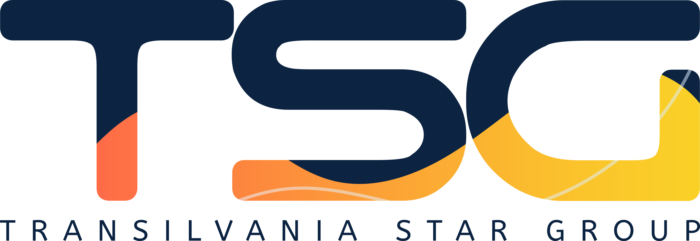
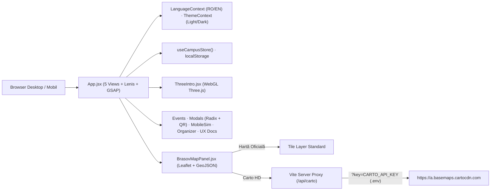

<div align="center">

<p align="center">
  <picture>
    <source media="(prefers-color-scheme: dark)" srcset="public/assets/branding/unitbv-symbol-white.png" />
    <source media="(prefers-color-scheme: light)" srcset="public/assets/branding/unitbv-symbol.png" />
    
  </picture>
  &nbsp;&nbsp;&nbsp;&nbsp;&nbsp;&nbsp;
  <picture>
    <source media="(prefers-color-scheme: dark)" srcset="public/assets/branding/tsg-logo-white.png" />
    <source media="(prefers-color-scheme: light)" srcset="public/assets/branding/tsg-logo-clean.png" />
    
  </picture>
</p>

# Evenimente UNITBV - Platformă Universitară Digitală

**Portal academic interactiv cu introducere 3D WebGL, descoperire inteligentă a evenimentelor, înregistrare academică QR în 18 facultăți și hartă geospațială a campusului din Brașov.**

Dezvoltat pentru **Universitatea Transilvania din Brașov (UNITBV)** în parteneriat cu **Transilvania Star Group (TSG)**.


[Pornire Rapidă](#pornire-rapidă) · [Funcționalități](#funcționalități-principale) · [Arhitectură](#arhitectură-software) · [Harta & Proxy API](#configurare-hartă--securitate-proxy) · [Responsivitate](#adaptabilitate-multi-rezoluție) · [Documentație PDF](Documentatie_Proiect_UNITBV_Events.pdf)

</div>

---

## De ce există această platformă?

Studenții, cadrele didactice și partenerii din industrie ai **UNITBV** au nevoie de un punct unic de acces pentru evenimentele academice, tehnice, culturale și de carieră din Brașov, fără informații fragmentate sau formulare generice.

**Evenimente UNITBV** rezolvă acest flux într-o aplicație Single-Page (SPA) rapidă, bilingvă (**RO / EN**) și adaptată nativ atât pentru ecrane desktop cât și pentru browsere mobile:
- Reduce înscrierea la evenimente la o matrice academică oficială în **18 facultăți** și **190 de specializări**, generând instantaneu un bilet cu **cod QR** unic (`UTBV-2026-XXXX`).
- Integrează **35 de obiective universitare UNITBV** pe harta interactivă a Municipiului Brașov și Poiana Brașov (cu mod dual *Hartă Oficială* și *Carto HD*).
- Oferă echipelor organizatoare un **Panou de Administrare** sincronizat în timp real pentru creare/editare evenimente, check-in participanți, anunțuri și moderare **Live Q&A**.

---

## Cerințe Preliminare

- **Node.js** `>= 18 LTS` (recomandat `v20 LTS` sau `v22 LTS`)
- **npm** `>= 9.0` (inclus automat în distribuția Node.js)
- O cheie API **Carto** (opțională pentru stratul *Carto HD*; stratul *Hartă Oficială* funcționează și fără cheie)

---

## Pornire Rapidă

Executați pașii de mai jos din directorul rădăcină al proiectului:

```bash
# 1. Instalați dependențele declarate în package.json
npm install

# 2. Configurați variabila privată de mediu pentru proxy-ul hărții Carto HD
echo "CARTO_API_KEY=cheia_dvs_carto" > .env

# 3. Porniți serverul de dezvoltare Vite (HMR + proxy /api/carto pe portul 5174)
npm run dev
```

Deschideți **[http://localhost:5174](http://localhost:5174)** în browser (Chrome, Firefox, Safari Desktop/iOS sau Chrome Android).

### Build de Producție & Preview Local

```bash
# Compilează bundle-ul optimizat în directorul dist/
npm run build

# Pornește serverul local de preview pe rețea (portul 5174) cu proxy /api/carto activ
npm run preview -- --host 0.0.0.0 --port 5174
```

<details>
<summary><strong>Exemplu de configurare proxy pentru deploy în producție (Nginx / Caddy)</strong></summary>

În spatele unui server web static, serviți conținutul directorului `dist/` și configurați rutarea proxy pentru ca cheia `CARTO_API_KEY` să nu fie expusă niciodată în codul client:

```nginx
server {
    listen 80;
    server_name evenimente.exemplu.ro;
    root /var/www/unitbv-events/dist;
    index index.html;

    location / {
        try_files $uri $uri/ /index.html;
    }

    location /api/carto/ {
        proxy_pass https://a.basemaps.cartocdn.com/;
        proxy_set_header Host a.basemaps.cartocdn.com;
        set $args $args&key=${CARTO_API_KEY};
    }
}
```

</details>

---

## Funcționalități Principale

| Modul | Implementare Cheie | Capabilități & Comportament Verificat |
| :--- | :--- | :--- |
| **Intro 3D WebGL** | `src/components/ThreeIntro.jsx` | Emblema **UNITBV** rasterizată în sute de voxeli PBR (`THREE.InstancedMesh`), repulsie elastică la cursor (`THREE.Raycaster`), tranziție Depth-of-Field (`2.6s`) și zbor cinematic prin centru. Funcționează atât full-screen cât și încorporat (`embedded`) în simulatorul mobil. |
| **Hub de Evenimente** | `src/App.jsx`, `FeaturedEvent.jsx`, `EventCard.jsx`, `CalendarView.jsx` | **9 evenimente** bilingve în **6 categorii**, căutare instantanee activabilă cu tasta `/`, filtrare multi-criteriu (Facultate, Locație, Format *Fizic / Hibrid / Online*), animații **GSAP** la schimbarea filtrelor și scroll la 60fps prin **Lenis**. |
| **Detalii & Live Q&A** | `src/components/EventDetailModal.jsx` | Modal Glassmorphism cu **5 tab-uri Radix UI** (*Despre + FAQ*, *Program*, *Vorbitori*, *Locație & Acces RATBv/Wi-Fi/Parcare*, *Live Q&A* cu upvote și întrebări noi). Oprește scroll-ul paginii de fundal când modalul este deschis. |
| **Înregistrare & Bilete QR** | `src/components/RsvpModal.jsx`, `src/data/unitbvAcademicData.js` | Matrice cascadată **2×2** cu toate cele **18 facultăți** și **190 de specializări acreditate UNITBV** (durată dinamică: `2 / 3 / 4 / 6 ani`), cod bilet generat via `qrcode` (`UTBV-2026-XXXX`) și portofel digital în *Biletele mele*. |
| **Harta Campus Brașov** | `src/components/BrasovMapPanel.jsx`, `src/data/brasovBoundary.js` | Hartă interactivă **Leaflet** pe conturul oficial **Brașov & Poiana Brașov** cu **35 de obiective UNITBV** (Colina, Centru, Memorandului, Aula, Zona Nord), stare inițială ne-preselectată, pop-up translucid cu link Google Maps și filtrare evenimente per clădire. |
| **Simulator Mobil** | `src/components/MobileSimulatorView.jsx` | Șasiu iOS (`385×810 px`) cu *Dynamic Island*, scroll izolat, re-lansare Intro 3D încorporat, scalare automată pentru ecrane înguste și sincronizare completă (inclusiv avatar `CURRENT_USER`) cu store-ul global. |
| **Panou Organizator** | `src/components/OrganizerView.jsx` | Accesibil prin comutatorul *Student / Organizator* din header: creare/editare evenimente (`EventForm`), promovare în secțiunea hero, validare check-in QR, trimitere anunțuri și răspunsuri oficiale în Q&A. |
| **Arhitectură UX** | `src/components/UxDocsView.jsx`, `src/data/uxDocsData.js` | Studiu de caz intern pe 4 sub-tab-uri (*User Flows*, *3 Personas & Empathy Maps*, *Atomic Design & Tokens*, *Audit Nielsen Norman & WCAG 2.1 AA*) pe panouri unitare `.glass-subtle` fără emoji-uri sau culori pastelate divergente. |

---

## Arhitectură Software

Platforma utilizează un singur hook reactiv de stare (`useCampusStore()` în `src/store.js`) susținut de persistență locală (`localStorage` / `sessionStorage`) și două contexte React dedicate pentru limbă (`LanguageContext`) și temă (`ThemeContext` - *Light Mode* instituțional albastru `#005A9C` și *Dark Mode* pe fundal neutru `#121212` cu accente aurii `#FBBF24`).



<details>
<summary><strong>Structura completă a proiectului (din sursele curente)</strong></summary>

```text
├── index.html                        # Document rădăcină (#121212 dark canvas, favicon)
├── package.json                      # Scripturi Vite & dependențe exacte
├── tailwind.config.js                # Configurație darkMode: 'class', font UT Sans, paletă UNITBV
├── vite.config.js                    # Port 5174 & proxy server-side /api/carto
├── Documentatie_Proiect_UNITBV_Events.pdf  # Documentația tehnică completă (10 pagini A4)
├── public/assets/
│   ├── branding/                     # Sigle oficiale UNITBV & TSG (PNG Light/Dark)
│   ├── fonts/                        # Font instituțional UT Sans (300/400/500/700 OTF) & UT Symbols
│   └── images/                       # Fotografii DSLR campus & avatare profil
└── src/
    ├── main.jsx                      # Punct de intrare React + Context Providers
    ├── index.css                     # Sistem Glassmorphism (.glass-surface, .glass-modal, .glass-subtle)
    ├── App.jsx                       # Orchestrator view-uri, filtrare sticky, short-cut tasta '/'
    ├── store.js                      # Hook useCampusStore(), CURRENT_USER & persistență browser
    ├── context/
    │   ├── LanguageContext.jsx       # State bilingv RO/EN + localizare etichete
    │   └── ThemeContext.jsx          # State temă Light/Dark + persistență unitbv_theme_preference
    ├── data/
    │   ├── brasovBoundary.js         # Conturul GeoJSON calibrat Brașov & Poiana Brașov
    │   ├── events.js                 # Catalog inițial evenimente, categorii & locații principale
    │   ├── i18n.js                   # Dicționar complet RO / EN
    │   ├── unitbvAcademicData.js     # Catalog oficial (18 facultăți, 190 specializări)
    │   └── uxDocsData.js             # Date studiu de caz UX (2 fluxuri, 3 personas, tokens, heuristici)
    └── components/
        ├── ThreeIntro.jsx            # Scenă WebGL voxeli UNITBV (Desktop & Mobil încorporat)
        ├── Header.jsx                # Bară utilitară, navigație responsive, căutare, notificări
        ├── CategoryFilterBar.jsx     # Selector categorii (scrollabil pe mobil, vertical pe desktop)
        ├── FilterToolbar.jsx         # Filtre Facultate / Locație / Format & comutator Grilă/Calendar
        ├── FeaturedEvent.jsx         # Card spotlight eveniment promovat
        ├── EventCard.jsx             # Card eveniment cu favorite & locuri disponibile
        ├── CalendarView.jsx          # Agendă cronologică pe zile
        ├── EventDetailModal.jsx      # Modal detalii 5 tab-uri + Live Q&A
        ├── RsvpModal.jsx             # Formular academic 2×2 & generator bilete QR
        ├── BrasovMapPanel.jsx        # Hartă Brașov + 35 obiective + panou căutabil
        ├── MobileSimulatorView.jsx   # Simulator aplicativ mobil auto-scalabil
        ├── OrganizerView.jsx         # Panou CRUD organizator, check-in QR, anunțuri, moderare Q&A
        ├── CampusInfo.jsx            # Tabel săli campus & portofel bilete active
        ├── UxDocsView.jsx            # Documentație UI/UX interactivă în 4 tab-uri
        └── Footer.jsx                # Subsol instituțional UNITBV × TSG
```

</details>

---

## Configurare Hartă & Securitate Proxy

- **Protecția cheii API:** Cheia privată Carto nu este inclusă în bundle-ul JavaScript servit browserului. `vite.config.js` citește `CARTO_API_KEY` prin `loadEnv()` și o atașează exclusiv la nivel de server pentru rutele `/api/carto`.
- **Ignorare Git:** Fișierul `.gitignore` exclude explicit `.env`, `.env.*`, `node_modules` și `dist`.
- **Comportament hartă:** Secțiunea *Locații* se deschide curat (`selectedBuildingId = null`), afișând tot perimetrul Brașovului; selectarea oricărei clădiri din listă sau de pe hartă centrează vizual camera și deschide cardul `#map-pin-popup`.

---

## Adaptabilitate Multi-Rezoluție

Interfața garantează zero overflow orizontal (`scrollWidth === innerWidth`) pe toate rezoluțiile de lucru verificate, fără a compromite panoul lateral fixat pe desktop (`overflow-x: clip` pe `body` și `min-w-0` pe coloanele grid):

| Rezoluție | Profil | Adaptare Navigație & Layout | Hartă & Simulator |
| :--- | :--- | :--- | :--- |
| **360×800 px** | Telefon Android | Bandă de navigație mobilă glisabilă (`lg:hidden`), căutare expandabilă la click, grilă `grid-cols-1`. | Hartă `h-[380px]`; Simulator scalat automat prin `viewportFitScale` (minim `0.65×`). |
| **375×812 px** | Browser Mobil / iOS | Până la 5 tab-uri în banda mobilă; modale centrate și tab-uri derulabile fără trunchieri. | `ResizeObserver` recalibrează Leaflet; Intro 3D folosește `startZ = 260` în portret. |
| **768×1024 px** | Tabletă Portret | Bandă mobilă + căutare compactă; filtrele secundare se grupează pe **3 coloane** (`sm:grid-cols-3`). | Hartă extinsă (`h-[480px]`), eveniment recomandat în layout orizontal `md:grid-cols-5`. |
| **1024×768 px** | Laptop Compact | Navigație inline completă în header (`lg:flex`), sidebar **sticky** permanent lângă grila de conținut. | Hartă `lg:h-[560px]` pe 12 coloane alături de directorul celor 35 de locații. |
| **1280px - 1920px+** | Desktop & Wide | Câmp de căutare permanent extins (`xl:block`), container lărgit până la `2xl:max-w-[1320px]`. | Simulator mobil la scară nativă `100%` (`385×810 px`) și Intro 3D la `startZ = 195`. |

---

## Scripturi Disponibile (`package.json`)

| Comandă | Efect |
| :--- | :--- |
| `npm run dev` | Pornește Vite Dev Server (`http://localhost:5174`) cu HMR și proxy `/api/carto`. |
| `npm run build` | Generează build-ul de producție minificat în directorul `dist/`. |
| `npm run preview` | Pornește serverul Vite Preview peste conținutul compilat din `dist/`. |

---

## Depanare Rapidă

- **Harta „Carto HD” nu încarcă tile-urile local:** Verificați existența fișierului `.env` în rădăcina proiectului cu variabila validă `CARTO_API_KEY=...` și reporniți `npm run dev` / `npm run preview`, astfel încât proxy-ul `/api/carto` să reîncarce variabila de mediu. Între timp, comutatorul **Hartă Oficială** funcționează independent de cheia Carto.
- **Portul `5174` este deja ocupat:** Opriți procesul anterior sau suprascrieți temporar portul cu `npm run dev -- --port 5175`.
- **Resetarea stării demonstrative locale (evenimente, bilete QR, preferințe):** Goliți `localStorage` și `sessionStorage` din DevTools (*Application → Storage → Clear site data*) și reîncărcați pagina pentru a revedea Intro-ul 3D și datele inițiale curate.

---

## Documentație Tehnică Completă

Pentru specificațiile detaliate ale tuturor modulelor (pipeline-ul Three.js, sistemul Glassmorphism `#121212`, catalogul integral al celor **18 facultăți și 190 specializări**, stratul cartografic **Carto HD**, responsivitatea multi-rezoluție și ghidul de operare), consultați documentul PDF dedicat din rădăcina proiectului:

- **[Documentatie_Proiect_UNITBV_Events.pdf](Documentatie_Proiect_UNITBV_Events.pdf)** *(10 pagini A4 · Tipografie oficială **UT Sans**)*
